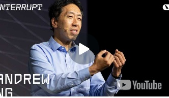

**Agente de IA: O Que Faz? Como Usa? Andrew Ng Explica (e a Resposta envolve 'Falar a Língua' dos Dados!)**

Recebi esse video em um dos inúmeros grupos de WhatsApp que participo e como é um assunto atual fiquei pensando em qual seria a relação de **Inteligência Artificial** com a **Literácia de Dados**.

Nele [Andrew Ng](https://www.andrewng.org/), que já pode ser considerado uma lenda da IA e [Harrison Chase](https://blog.langchain.dev/author/harrison/) criador do LangChain, falam justamente sobre isso.

Assistir à essa entrevista me fez pensar sobre como aquela conversa se conecta com o assunto de nosso blog.

Durante a entrevista, Ng começa explicando que, em vez de ficar discutindo se algo é ou não é um agente de IA, é melhor pensar no grau de *agenticidade* que um sistema tem – ou seja, o quão **autônomo** ele consegue ser. Para construir esses sistemas, que têm algum nível de autonomia, Ng diz que tem: desde coisas mais simples, como automatizar um processo de negócio que é um pouco linear, como "olhar um formulário, buscar na web e colar em outro lugar", até fluxos bem mais complexos. Mas o ponto que conecta com a nossa ideia de **alfabetização de dados** é o seguinte: para qualquer um desses sistemas multi-agentes funcionar bem, ele precisa de informação – ou seja, de **dados!** Andrew Ng, comenta que um dos grandes desafios hoje é pegar o que as pessoas fazem (que muitas vezes envolve lidar com dados de vários lugares) e transformar isso num fluxo para IA. Ele disse que se gasta muito de tempo na ingestão dos dados para processá-los. Como achar onde os dados estão (em formulários, bases de dados, na web), conseguir acessar e "dar na mão" do modelo de linguagem (LLM). Sabe por quê? Porque, como ele disse, os LLMs são "bastante inteligentes" quando você lhes dá o "contexto correto". E adivinha de onde vem esse contexto dos dados?

> **Isso, para mim, é a alfabetização de dados na veia!**

Não adianta ter o LLM super potente se você não sabe quais dados ele precisa, onde encontrá-los, como juntá-los e como apresentá-los para ele entender o que fazer. É ter a capacidade de compreender os dados, saber usá-los e comunicá-los como explicado na conceituação de **alfabetização de dados**, apresentado em uma conversa [anterior](https://www.dataliteracy.com.br/posts/alfabetizacao-de-dados/).

Ng mencionou uma ferramenta chamada [MCP](https://softdesign.com.br/blog/model-context-protocol/) (Model Context Protocol) que é um passo legal para tentar padronizar a forma de se conectar a diferentes fontes de dados e ferramentas. A ideia é que, em vez de ter que criar uma conexão única para cada ferramenta e cada fonte de dados - o que daria um trabalhão - que você tenha um padrão que facilite essa "conversa". Isso ajuda diretamente na parte da alfabetização de dados ligada à integração e acesso à informação.

Em minha opinião, o que ele falou, e que se alinha com a alfabetização de dados, é que uma das habilidades mais importantes para o futuro, para todo mundo (não só para quem programa como profissão!), vai ser conseguir dizer para o computador exatamente o que você quer que ele faça. Muitas vezes, dizer para o computador o que fazer significa instruir ele a buscar, analisar ou manipular dados. Ter uma noção de como o computador "pensa" e lida com a informação – mesmo que não seja no nível de um engenheiro de software – permite dar instruções muito mais precisas. No vídeo Ng encoraja a todo mundo, aprender pelo menos uma linguagem de programação (tipo Python) para ter essa base, não para se tornar um dev, mas para melhorar a comunicação com a máquina sobre as tarefas que envolvem dados.

Ng menciona também a importância de testar (fazer "evals") para ver se o sistema está funcionando direito, o que também envolve analisar os resultados (dados de saída), e como isso se parece com um monte de "peças de Lego" (ferramentas de IA) para montar esses sistemas. Saber quais peças lidar com dados (como as de busca, memória, etc.) e como usá-las faz parte desse quebra-cabeça.

Resumo da ópera! Para mim, nesse mundo de IA cada vez mais autônomo, saber lidar com dados, entender de onde eles vêm, como se juntam e, principalmente, como "falar a língua" dos dados para instruir o computador, é uma habilidade fundamental que está totalmente ligada a **alfabetização de dados**. Não é só para quem está construindo os robôs, mas para quem vai usá-los para resolver problemas no dia a dia.

> **🤖 É um novo tipo de leitura e escrita para o século XXI!**

EDA \| TESTE T \| ENQUETES \| ANOVA \| MODELOS DE REGRESSÃO \| ANÁLISE FATORIAL \| MODELAGEM DE EQUAÇÕES ESTRUTURAIS \| TRI \| RASCH MODELS \| MACHINE LEARNING

{width="20" height="20"} [**Prof. Jobenil Júnior**](https://wa.me/5562992138972)
