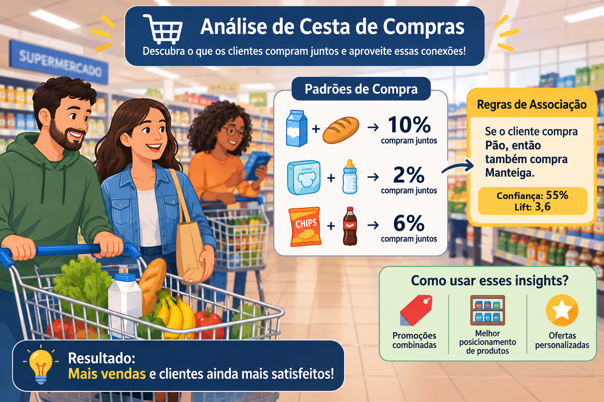

Existe uma história que todo professor de mineração de dados já contou pelo menos uma vez (eu incluído). Uma grande rede de supermercados americana teria analisado milhões de cupons fiscais e descoberto algo bizarro: **na sexta-feira à noite, quem comprava fraldas também comprava cerveja**. A explicação? Pais jovens, mandados ao mercado para buscar fraldas, aproveitavam para levar a cervejinha do fim de semana. Moral da história: a rede colocou as cervejas ao lado das fraldas e as vendas dispararam.

Bonita, não é? O problema é que a parte do "final feliz" é **lenda**. A análise original (feita para a rede de farmácias Osco Drug, por volta de 1992) até encontrou uma correlação desse tipo, mas ninguém mudou prateleira nenhuma. **Verdade ou lenda?** Guarde essa pergunta: hoje vamos respondê-la com dados, com três métricas e com um mapa.

{fig-align="center" width="100%"}

E já que estamos no supermercado, fica uma pergunta prática para você ir pensando: **se você fosse o gerente, colocaria a manteiga perto ou longe do pão?**

No [post sobre K-Means](../kmeans_segmentacao_de_mercado/index.qmd), nós respondemos à pergunta *"quem é o meu cliente?"*, agrupando pessoas parecidas em segmentos. Hoje a pergunta é outra: **"o que se compra junto?"**. Bem-vindo à **Análise de Cesta de Compras** (em inglês, *Market Basket Analysis*).

## 🛒 O que é Análise de Cesta de Compras?

Pense no cupom fiscal que você recebe no caixa. Para o algoritmo, cada cupom é uma **transação**, e cada transação é simplesmente um **conjunto de itens**: `{pão, leite, café}`. Não importa se você levou um ou dez pacotes de café, nem quanto pagou; só importa se o item **estava ou não** no carrinho.

O objetivo é encontrar **regras de associação** do tipo:

> **SE** o cliente leva {pão} **ENTÃO** ele também leva {manteiga}

O lado do "SE" se chama **antecedente** (ou LHS, *left-hand side*) e o lado do "ENTÃO" se chama **consequente** (ou RHS, *right-hand side*). Assim como o K-Means, é aprendizado **não supervisionado**: ninguém diz ao algoritmo qual é a resposta certa. Ele vasculha os cupons e devolve os padrões que aparecem com frequência.

|   | K-Means | Cesta de Compras (Apriori) |
|----|----|----|
| Pergunta | Quem é o cliente? | O que se compra junto? |
| Unidade de análise | Clientes | Cupons (transações) |
| Resultado | Segmentos de clientes | Regras "SE... ENTÃO..." entre produtos |
| Uso típico | Campanhas por perfil | Combos, layout da loja, recomendações |

## 🧸 Imagine assim:

Sabe aquela moça do caixa que trabalha há vinte anos no mesmo supermercado? Ela "sabe" que quem passa com carvão vai passar com carne. Que quem leva fralda costuma levar lenço umedecido. Ninguém ensinou isso a ela: foi a repetição, cupom após cupom.

O algoritmo **Apriori** é essa moça do caixa com memória perfeita para milhões de cupons. Só que ela tem um defeito: **sozinha, não sabe diferenciar o óbvio do interessante, nem o interessante da coincidência**. Para isso, ela precisa de três métricas. Vamos aprendê-las com papel e caneta.

## 🧾 Mão na massa: 10 cupons de papel

Antes de qualquer código, imagine que o dia foi fraco e só passaram 10 clientes pelo caixa:

| Cupom | Itens                           |
|:-----:|---------------------------------|
|   1   | pão, manteiga, leite            |
|   2   | pão, manteiga, café             |
|   3   | pão, leite                      |
|   4   | leite, café                     |
|   5   | pão, manteiga                   |
|   6   | salgadinho, refrigerante        |
|   7   | leite, salgadinho, refrigerante |
|   8   | pão, leite, café                |
|   9   | leite, refrigerante             |
|  10   | pão, manteiga, leite            |

Contando: **pão** aparece em 6 cupons, **manteiga** em 4, **leite** em 7. Pão e manteiga aparecem **juntos** em 4 cupons; pão e leite também aparecem juntos em 4 cupons.

## 📏 As três métricas que separam o ouro do cascalho

| Métrica | Pergunta que responde | Fórmula | Leitura |
|----|----|----|----|
| **Suporte** | Com que frequência os itens aparecem juntos? | P(A e B) | Popularidade da combinação |
| **Confiança** | Entre quem leva A, quantos levam B? | P(B \| A) = suporte(A e B) / suporte(A) | Força da regra |
| **Lift** | Levar A **aumenta** a chance de levar B? | confiança / suporte(B) | \> 1 atração; = 1 independência; \< 1 repulsão |

Vamos calcular para duas regras com os nossos 10 cupons:

| Regra              |    Suporte     |    Confiança    |          Lift           |
|--------------------|:--------------:|:---------------:|:-----------------------:|
| {pão} → {manteiga} | 4/10 = **40%** | 4/6 = **66,7%** | 0,667 / 0,40 = **1,67** |
| {pão} → {leite}    | 4/10 = **40%** | 4/6 = **66,7%** | 0,667 / 0,70 = **0,95** |

Repare no que aconteceu: as duas regras têm **exatamente o mesmo suporte e a mesma confiança**. Se você olhasse só para a confiança, diria que são igualmente boas. Mas o lift conta outra história:

- Quem leva pão leva manteiga **1,67 vez mais** do que um cliente qualquer. Existe atração de verdade.
- Quem leva pão leva leite em 66,7% das vezes... mas **70% de todos os clientes** já levam leite! Levar pão não aumenta em nada a chance de levar leite (lift 0,95, praticamente 1).

> **Confiança alta não basta. Sem o lift, você pode estar só "descobrindo" que o leite é popular.**

E aqui vai um exercício de alfabetização de dados com a capa deste post: o par **leite + pão** é o mais frequente de todos (10% dos cupons). Mais adiante você vai ver que ele é justamente o **menos interessante**. Por quê? Exatamente pelo motivo acima.

## 🧠 Por que "Apriori"? O truque que evita a explosão

Calcular as métricas para 2 regras é fácil. O problema é que um supermercado de bairro tem milhares de produtos. Com apenas 21 itens já existem 2²¹ ≈ **2 milhões** de combinações possíveis; com 169 itens (o tamanho de uma base clássica que veremos no final), são cerca de **7 × 10⁵⁰** combinações. Nenhum computador conta tudo isso.

O truque do Apriori, proposto por Agrawal e Srikant em 1994, é uma ideia de bom senso chamada **propriedade Apriori**:

> **Se uma combinação é rara, qualquer combinação maior que a contenha também é rara.**

Se pouca gente compra caviar, menos gente ainda compra caviar **e** pão, e menos ainda caviar, pão **e** vinho. Então, assim que o caviar for reprovado, todas as combinações com ele são **podadas** sem precisar ser contadas. Vejamos com os 10 cupons, exigindo suporte mínimo de 30% (3 cupons):

| Passo | O que acontece | Resultado |
|----|----|----|
| 1\. Contar itens | pão 6, leite 7, manteiga 4, café 3, refrigerante 3, salgadinho 2 | Salgadinho **reprovado** (2 \< 3) |
| 2\. Formar pares só com os aprovados | {salgadinho, refrigerante} **nem é contado** | Poda! |
| 3\. Contar pares | {pão, manteiga} 4 e {pão, leite} 4 passam; os demais têm 2 ou menos | 2 pares frequentes |
| 4\. Formar trios | {pão, manteiga, leite} exigiria {manteiga, leite} frequente, que não é | Trio **podado sem contar** |
| 5\. Gerar regras | A partir dos pares frequentes, calcular confiança e lift | {pão} → {manteiga}, {pão} → {leite}... |

É por isso que o algoritmo se chama Apriori: ele usa um conhecimento **prévio** (os itens frequentes da etapa anterior) para decidir o que vale a pena contar na etapa seguinte.

## 🏪 O Supermercado Bom Preço: 5.000 cupons

Agora vamos para uma escala mais realista. Vou simular 5.000 cupons de um supermercado fictício, o **Bom Preço**, com 21 produtos. Cada produto tem uma chance própria de entrar no carrinho e, por cima disso, eu **plantei** algumas associações, como um gabarito escondido que o Apriori precisa reencontrar:

| Associação plantada | O que esperar |
|----|----|
| pão → manteiga | A regra clássica da capa |
| fralda → lenço umedecido e mamadeira | O "kit bebê" |
| salgadinho → refrigerante | O combo do petisco |
| carvão → carne e cerveja | O "kit churrasco" |
| fralda → cerveja | A lenda, mas **fraquinha** |
| leite | Muito popular (40%), **sem associação nenhuma** |

```{r warning=FALSE, message=FALSE}
library(arules)
library(arulesViz)
library(dplyr)
library(ggplot2)
library(gt)

set.seed(2026)

n <- 5000
base <- c("pão" = 0.25, "leite" = 0.40, "café" = 0.20, "açúcar" = 0.12,
          "arroz" = 0.25, "feijão" = 0.22, "ovos" = 0.18, "banana" = 0.20,
          "tomate" = 0.18, "queijo" = 0.10, "salgadinho" = 0.12,
          "refrigerante" = 0.15, "fralda" = 0.06, "carvão" = 0.05,
          "carne" = 0.15, "cerveja" = 0.14, "detergente" = 0.10,
          "papel higiênico" = 0.12, "lenço umedecido" = 0.02, "mamadeira" = 0.01)

cupons <- lapply(seq_len(n), function(i) {
  itens <- names(base)[runif(length(base)) < base]
  # associações plantadas (o "gabarito" que o Apriori deve reencontrar)
  if ("pão" %in% itens        && runif(1) < 0.55) itens <- c(itens, "manteiga")
  if (!"pão" %in% itens       && runif(1) < 0.02) itens <- c(itens, "manteiga")
  if ("fralda" %in% itens     && runif(1) < 0.70) itens <- c(itens, "lenço umedecido")
  if ("fralda" %in% itens     && runif(1) < 0.40) itens <- c(itens, "mamadeira")
  if ("fralda" %in% itens     && runif(1) < 0.10) itens <- c(itens, "cerveja")  # a "lenda"
  if ("salgadinho" %in% itens && runif(1) < 0.45) itens <- c(itens, "refrigerante")
  if ("carvão" %in% itens     && runif(1) < 0.75) itens <- c(itens, "carne")
  if ("carvão" %in% itens     && runif(1) < 0.65) itens <- c(itens, "cerveja")
  if (length(itens) == 0) itens <- sample(names(base), 1)  # nenhum cupom vazio
  unique(itens)
})

trans <- as(cupons, "transactions")
summary(trans)
```

A função `as(cupons, "transactions")` transforma a lista de cupons no formato que o `{arules}` entende: uma matriz esparsa de 5.000 linhas (cupons) por 21 colunas (itens). O `summary()` mostra que o cupom médio tem **3,4 itens** e que o campeão de vendas é o **leite**, presente em 1.980 cupons. Vamos ver o ranking completo:

```{r warning=FALSE, message=FALSE, fig.width=8, fig.height=6}
freq <- tibble(item = itemLabels(trans), suporte = itemFrequency(trans)) |>
  arrange(desc(suporte))

ggplot(freq, aes(x = suporte, y = reorder(item, suporte), fill = item == "leite")) +
  geom_col(show.legend = FALSE) +
  scale_fill_manual(values = c("grey70", "#1f4e79")) +
  scale_x_continuous(labels = scales::percent) +
  labs(x = "Suporte (% dos cupons)", y = NULL,
       title = "O que mais sai no Supermercado Bom Preço") +
  theme_minimal(base_size = 14)
```

O leite está em **39,6%** dos cupons, bem à frente de arroz e pão (cerca de 25% cada). Guarde esse campeão de vendas na memória: ele vai aprontar.

## ⚙️ Rodando o Apriori no R

Com os dados prontos, rodar o algoritmo é uma linha. Precisamos apenas dizer os limiares mínimos:

```{r warning=FALSE, message=FALSE}
regras <- apriori(trans,
                  parameter = list(supp = 0.01,   # aparece em pelo menos 1% dos cupons
                                   conf = 0.30,   # confiança mínima de 30%
                                   minlen = 2),   # pelo menos 1 item de cada lado
                  control = list(verbose = FALSE))
length(regras)

regras <- regras[!is.redundant(regras)]
length(regras)
```

O Apriori encontrou **215 regras**. Muitas delas, porém, são **redundantes**: uma regra como {pão, ovos} → {manteiga} é redundante quando não tem confiança maior que a regra mais simples {pão} → {manteiga}. O ovo só pegou carona. Removendo as redundantes com `is.redundant()`, sobram **130 regras**.

Sobre os limiares: não existe valor mágico. Suporte baixo demais gera milhares de regras raras (e muitas coincidências); suporte alto demais deixa só o óbvio. Um bom hábito é testar alguns valores e reportar quais foram usados.

Mesmo assim, 130 regras numa tabela ninguém lê. Precisamos de **critério** e de um **mapa**. Para facilitar, vou criar uma pequena função que transforma regras numa tabela bonita com o `{gt}`:

```{r warning=FALSE, message=FALSE}
tabela_regras <- function(r) {
  DATAFRAME(r) |>
    select(LHS, RHS, support, confidence, lift, count) |>
    gt() |>
    cols_label(LHS = "SE (antecedente)", RHS = "ENTÃO (consequente)",
               support = "Suporte", confidence = "Confiança",
               lift = "Lift", count = "Cupons") |>
    fmt_percent(columns = c(support, confidence), decimals = 1) |>
    fmt_number(columns = lift, decimals = 2)
}
```

## 📊 Interpretação: regras boas, óbvias, enganosas e de acaso

### 1. O ranking por lift: o kit bebê e os "caronas"

```{r warning=FALSE, message=FALSE}
tabela_regras(head(sort(regras, by = "lift"), 10))
```

O topo do ranking é todo do **kit bebê**, com lifts acima de 10: quem leva fralda tem mais de 10 vezes a chance de levar lenço umedecido do que um cliente qualquer. Verdadeiro? Sim. Surpreendente? Nem um pouco. É uma regra **óbvia**: qualquer repositor de supermercado sabe disso.

Repare também em regras como {arroz, fralda} → {lenço umedecido}. O arroz não tem nada a ver com a história; ele **pegou carona** numa regra forte e, por puro acaso, ficou com confiança ligeiramente maior (por isso o `is.redundant()` não a eliminou). Lição prática: **comece sempre pelas regras curtas**, de dois itens.

### 2. A armadilha do leite

Agora vamos olhar só as regras de dois itens, ordenadas por **confiança**:

```{r warning=FALSE, message=FALSE}
pares <- subset(regras, size(regras) == 2)
tabela_regras(head(sort(pares, by = "confidence"), 10))
```

Lá no décimo lugar aparece {manteiga} → {leite}, com confiança de **42,6%**: quase metade de quem leva manteiga leva leite. Impressionante? Não! **Quase 40% de todo mundo** leva leite. O lift de 1,08 denuncia: levar manteiga praticamente não muda a chance de levar leite.

E o leite não está sozinho nessa. Quantas das 130 regras terminam em leite?

```{r warning=FALSE, message=FALSE}
regras_leite <- subset(regras, rhs %in% "leite")
length(regras_leite)
summary(quality(regras_leite)$lift)
```

São **49 regras** (mais de um terço do total!), todas com lift entre 0,92 e 1,28. Elas passaram no filtro só porque o leite é tão popular que qualquer regra "→ leite" já nasce com confiança perto de 40%, acima do nosso limiar de 30%. É ruído com cara de descoberta.

E o par da capa, leite + pão? No sentido {pão} → {leite} ele está entre essas 49 regras. Já no sentido {leite} → {pão}, a confiança fica em 25%, abaixo do nosso limiar de 30%, o mesmo que acontece com a regra da lenda. Para enxergar as duas, rodo o Apriori de novo com limiares mais baixos:

```{r warning=FALSE, message=FALSE}
r_baixo <- apriori(trans, parameter = list(supp = 0.003, conf = 0.05, minlen = 2),
                   control = list(verbose = FALSE))

tabela_regras(subset(r_baixo, (lhs %oin% "pão"    & rhs %in% "manteiga") |
                              (lhs %oin% "leite"  & rhs %in% "pão") |
                              (lhs %oin% "fralda" & rhs %in% "cerveja")))
```

Aqui estão os números da capa do post:

- **{pão} → {manteiga}**: suporte de 13,3%, confiança de 52,6% e lift de **3,52**. A regra que plantamos, reencontrada pelo algoritmo. (A capa arredonda para 55% e 3,6.)
- **{leite} → {pão}**: suporte de **10%**, o par mais frequente da capa... e lift de **0,999**. Independência perfeita: os dois aparecem juntos o tempo todo simplesmente porque ambos são populares.
- **{fralda} → {cerveja}**: confiança de 28,9% e lift de **1,56**, em 92 cupons. A associação existe, mas é modesta.

### 3. As regras que valem dinheiro

Agora a tabela que eu levaria para a reunião com o gerente: as regras de dois itens com lift acima de 1,2.

```{r warning=FALSE, message=FALSE}
tabela_regras(sort(subset(pares, lift > 1.2), by = "lift"))
```

Classificando cada uma com olhar de negócio:

| Tipo | Exemplos | O que fazer |
|----|----|----|
| ✅ **Acionável** | salgadinho → refrigerante (lift 2,85), pão → manteiga (3,52), carvão → carne (3,92) | Combos, posicionamento, promoções |
| 😴 **Óbvia** | fralda → lenço umedecido (10,5), fralda → mamadeira (11,6) | Verdadeira, mas pouco surpreendente: melhor uso é recomendação automática |
| 🎲 **Acaso** | mamadeira → arroz (lift 1,25, só 53 cupons) | **Não** plantamos isso! Suporte baixo + lift pouco acima de 1 = desconfie |

A regra mamadeira → arroz é um ótimo lembrete: o Apriori vasculha **tudo**, e em 5.000 cupons sempre aparece alguma coincidência que passa nos filtros.

Para ver as 130 regras de uma vez, um gráfico de suporte × confiança, colorido pelo lift:

```{r warning=FALSE, message=FALSE, fig.width=8, fig.height=5.5}
ggplot(DATAFRAME(regras), aes(support, confidence, colour = lift)) +
  geom_point(size = 3, alpha = 0.8) +
  scale_colour_gradient(low = "grey80", high = "#c0392b", trans = "log10",
                        breaks = c(1, 2, 5, 10)) +
  scale_x_continuous(labels = scales::percent) +
  scale_y_continuous(labels = scales::percent) +
  labs(x = "Suporte", y = "Confiança", colour = "Lift",
       title = "Nem toda regra confiante é interessante") +
  theme_minimal(base_size = 14)
```

A escala de cor está em logaritmo para que lift 1 (independência) fique cinza e só as atrações de verdade fiquem vermelhas. Repare na "prateleira" de pontos cinzentos em torno de 40% de confiança, espalhada por vários níveis de suporte: são, em grande parte, as 49 regras do leite, com confiança "respeitável" e lift ≈ 1. Os pontos mais vermelhos, poucos e com suporte pequeno, são o kit bebê. E os dois pontos isolados lá na direita, com suporte de 13%, são o nosso par pão e manteiga, nos dois sentidos: {manteiga} → {pão} em cima (88,9%) e {pão} → {manteiga} embaixo (52,6%).

## 🕸️ O mapa do carrinho: grafo de regras com arulesViz

Tabelas mostram as regras uma a uma. Um **grafo** mostra como os produtos se **conectam**, e os padrões saltam aos olhos. O pacote `{arulesViz}`, de Michael Hahsler, faz isso com uma linha. Antes de olhar, veja como ler:

| Elemento | O que representa |
|----|----|
| Nome de produto | Um **produto** |
| Círculo | Uma **regra** |
| Seta produto → círculo | O produto está no **SE** (antecedente) |
| Seta círculo → produto | O produto está no **ENTÃO** (consequente) |
| Tamanho do círculo | **Suporte** (em quantos cupons a regra aparece) |
| Cor do círculo | **Lift** (quanto mais vermelho, mais forte a atração) |

Um grafo com 130 regras vira um prato de espaguete. Por isso, vou selecionar só as regras de dois itens com lift acima de 1,2, mais as regras de três itens do churrasco:

```{r warning=FALSE, message=FALSE, fig.width=10, fig.height=8}
grafo <- subset(regras, lift > 1.2 &
                  (size(regras) == 2 |
                   lhs %ain% c("carne", "cerveja") |
                   lhs %ain% c("carvão", "carne")))
grafo <- sort(grafo[!is.redundant(grafo, measure = "lift")], by = "lift")

set.seed(2026)  # o layout do grafo também tem uma parte aleatória
plot(grafo, method = "graph", engine = "ggplot2",
     control = list(
       layout = "stress",
       edges  = ggraph::geom_edge_link(
         colour = "grey55", alpha = 0.7,
         start_cap = ggraph::circle(4, "mm"), end_cap = ggraph::circle(4, "mm"),
         arrow = grid::arrow(length = grid::unit(2.5, "mm"), type = "closed")),
       colors = c("#c0392b", "#f6e3a1"))) +
  labs(title = "As 4 'ilhas' do carrinho no Supermercado Bom Preço",
       size = "Suporte", colour = "Lift") +
  theme(plot.title = element_text(size = 16, face = "bold"))
```

O argumento `engine = "ggplot2"` desenha o grafo com o `{ggraph}`, o que permite personalizar setas, cores e título como em qualquer `ggplot`. O `layout = "stress"` posiciona os nós de forma a evitar sobreposições.

Olhe com calma e você vai ver **quatro "ilhas"**, quatro **missões de compra** diferentes:

| Ilha | Produtos | Leitura de negócio |
|----|----|----|
| ☕ Café da manhã | pão ⇄ manteiga | Os maiores círculos do mapa (maior suporte), lift moderado |
| 🔥 Churrasco | carvão, carne, cerveja | A rede mais densa, com regras de três itens: candidata a "kit" na ponta de gôndola |
| 👶 Bebê | fralda, lenço umedecido, mamadeira | Os círculos mais vermelhos (lift altíssimo), mas óbvios |
| 🍿 Petisco | salgadinho ⇄ refrigerante | O combo clássico |

E três achados que a tabela não mostrava com tanta clareza:

1.  **O leite não aparece no mapa.** O produto mais vendido da loja não está conectado a nada. Ele está em quase 40% dos cupons, mas não "puxa" nem é "puxado" por nenhum outro produto.
2.  **A cerveja está na ilha do churrasco, não na do bebê.** A regra da lenda, fralda → cerveja, nem passou no filtro de lift. Veredito: a associação existe nos nossos dados, mas é modesta. Uma boa história não substitui uma boa métrica.
3.  **Os galhos soltos.** A seta mamadeira → arroz, pendurada na ilha do bebê, é a coincidência que já tínhamos identificado. E há uma "ponte" fina entre o churrasco e o pão ({carne, carvão} → {pão}, lift 1,33), que também **não** foi plantada. Círculos pequenos e claros são sempre os primeiros suspeitos.

> **O produto mais vendido da loja não tem nenhuma regra interessante. Popular não é o mesmo que conectado.**

Repare que as ilhas lembram os clusters do [post sobre K-Means](../kmeans_segmentacao_de_mercado/index.qmd), mas com uma diferença importante: lá agrupamos **clientes** pelo perfil; aqui, os grupos são de **produtos**, formados pelas compras.

### A versão interativa

Como este blog é uma página HTML, dá para fazer melhor ainda: trocando para `engine = "htmlwidget"`, o mesmo grafo vira um mapa interativo. **Arraste os nós, use o zoom e passe o mouse sobre os círculos** para ver o suporte, a confiança e o lift de cada regra:

```{r warning=FALSE, message=FALSE}
plot(grafo, method = "graph", engine = "htmlwidget")
```

## 💰 Como usar esses insights

Voltando ao painel verde da capa, as regras viram três tipos de ação:

| Uso | Ilha / regra | Cuidado |
|----|----|----|
| Promoções combinadas | 🍿 salgadinho + refrigerante; 🔥 kit churrasco | Não dar desconto para quem já compraria os dois de qualquer jeito |
| Posicionamento de produtos | ☕ manteiga **perto** do pão (conveniência) ou **longe** (o cliente atravessa a loja e vê outros produtos no caminho) | As duas estratégias existem: depende do objetivo da loja |
| Ofertas personalizadas | 👶 "quem levou fralda também levou..." no aplicativo ou no e-commerce | Regras óbvias cansam o cliente: prefira lift alto **e** alguma surpresa |

Uma conta de guardanapo: dos 1.264 cupons com pão, **599 saíram sem manteiga**. Se uma ação de gôndola convencer uma parte desses clientes, quanto isso vale? Depende de quantos converterem e da margem da manteiga, dois números incertos. Para lidar com essa incerteza, o caminho é o que mostrei no [post sobre Simulação de Monte Carlo para o ROI de campanhas](../simulacao_monte_carlo_roi_campanhas/index.qmd).

## ⚠️ Cuidados antes de levar o Apriori para a sua loja

| Cuidado | Por quê |
|----|----|
| Associação não é causalidade | A regra mostra que os itens aparecem juntos, não que um **causa** a compra do outro. Para saber se mudar a gôndola aumenta as vendas, faça um [Teste A/B](../teste_ab_significancia_e_tamanho_do_efeito/index.qmd) |
| Itens populares enganam | Confiança respeitável com lift ≈ 1 (as 49 regras do leite) |
| Regras raras ou de acaso | Suporte baixo e lift pouco acima de 1 (mamadeira → arroz) |
| Regras "carona" | Itens que entram de carona em regras fortes ({arroz, fralda} → lenço) |
| Escolha dos limiares | Muda completamente o resultado; teste alguns valores e reporte |
| Grafos poluídos | Filtre antes de desenhar; um grafo com centenas de regras não comunica nada |
| Quantidade e preço somem | A transação é binária: comprou ou não comprou |
| Tempo e sazonalidade | As regras de dezembro não são as de julho; o churrasco é mais forte no fim de semana |
| Segmentos diferentes | As regras podem mudar de um perfil de cliente para outro; vale rodar o Apriori dentro de cada segmento do K-Means |

## 🎯 Em resumo:

| Etapa | O que fizemos | Ferramenta no R |
|----|----|----|
| Preparar | Transformar cupons em transações | `as(lista, "transactions")` |
| Explorar | Ver os itens mais frequentes | `itemFrequency()` + `ggplot2` |
| Minerar | Encontrar itemsets frequentes e regras | `apriori()` |
| Filtrar | Ordenar por lift e remover redundantes | `sort()`, `subset()`, `is.redundant()` |
| Interpretar | Separar acionáveis, óbvias, enganosas e de acaso | `DATAFRAME()` + `gt` |
| Visualizar | Desenhar o mapa das regras | `arulesViz::plot(method = "graph")` |
| Decidir | Combos, layout, recomendações | Teste A/B antes de escalar |

1.  A Análise de Cesta de Compras procura regras **"SE... ENTÃO..."** entre produtos, a partir dos cupons fiscais.
2.  **Suporte** mede a frequência, **confiança** mede a força e **lift** mede se existe atração de verdade.
3.  O Apriori é rápido porque **poda** combinações que contêm itens raros, sem precisar contá-las.
4.  Confiança sem lift engana: o leite gerou **49 regras** com confiança de \~40% e nenhuma relevância.
5.  O grafo do `{arulesViz}` revela as **missões de compra** (as ilhas) e expõe as coincidências.
6.  O produto mais vendido não é, necessariamente, o mais conectado.

Quer praticar? O próprio `{arules}` traz uma base real, o `Groceries`, com 9.835 cupons e 169 produtos de um supermercado. Basta rodar `data("Groceries")` e repetir os passos deste post. Desafio: desenhe o grafo das 20 regras de maior lift e me conte quantas ilhas você encontrou. Para se aprofundar, o capítulo 6 do livro **Data Mining: Concepts and Techniques**, de Jiawei Han, Micheline Kamber e Jian Pei, é a referência clássica sobre o tema.

E aquela pergunta do começo: manteiga perto ou longe do pão? Agora você sabe que a resposta começa por um número (o lift de 3,52 diz que a associação é real) e termina numa decisão de negócio (conveniência ou passeio pela loja?). E se alguém contar a história das fraldas e cervejas na próxima reunião, você já pode perguntar: *"Qual era o lift?"*

> **Isso, para mim, é a alfabetização de dados na veia!**

EDA \| TESTE T \| ENQUETES \| ANOVA \| MODELOS DE REGRESSÃO \| ANÁLISE FATORIAL \| MODELAGEM DE EQUAÇÕES ESTRUTURAIS \| TRI \| RASCH MODELS \| MACHINE LEARNING

{width="20" height="20"} [**Prof. Jobenil Júnior**](https://wa.me/5562992138972)
