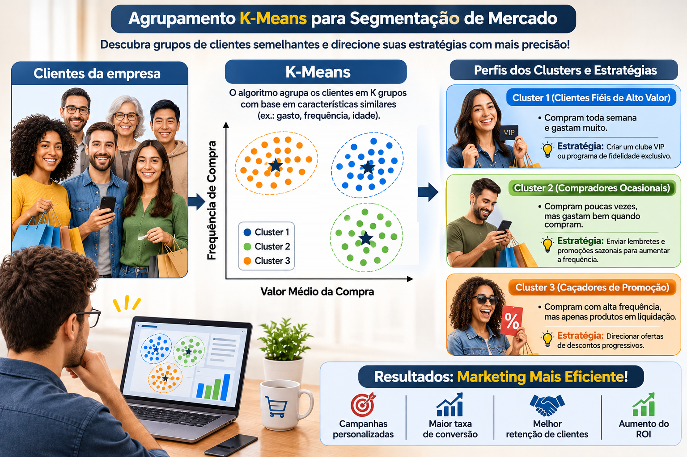

Na semana passada, a sua loja virtual disparou o mesmo cupom de 10% de desconto para os 1.000 clientes da base. A cliente que compra toda semana e nem olha preço usou o cupom numa compra que faria de qualquer jeito: você só perdeu margem. O cliente que aparece de vez em quando nem abriu o e-mail. E o caçador de liquidação? Esse adorou, mas comprou só o item mais barato da vitrine. **Mesmo cupom, três reações completamente diferentes.** E se, em vez de falar com "a média dos clientes" (que, como veremos, não existe), você descobrisse automaticamente **quais grupos de clientes se comportam de forma parecida**? É exatamente isso que o **K-Means** faz, e hoje vamos rodá-lo do zero, em Python.

{fig-align="center" width="100%"}

Lembra do [post sobre PCA](../reducao_dimensionalidade_pca_consumo_beleza/index.qmd), aquele das consumidoras de beleza? Lá eu terminei prometendo que o próximo passo natural seria agrupar as clientes em **perfis de compra** com um algoritmo de segmentação. Promessa é dívida: chegou a hora do K-Means.

## 🧺 Organizando a feira sem etiquetas

Imagine que despejaram na sua mesa 1.000 frutas **sem nenhuma etiqueta** e pediram para você separá-las em três cestos. Você não sabe o nome de nenhuma delas, mas olha a cor, o tamanho, o peso... e vai juntando as parecidas. No final, um cesto tem coisas pequenas e vermelhas, outro tem coisas grandes e verdes, e o terceiro tem coisas compridas e amarelas. Ninguém te deu o gabarito: você só **encontrou semelhanças**.

Isso é o que chamamos de **aprendizado não supervisionado**. É bem diferente do que fizemos no [post de previsão de churn](../regressao_logistica_previsao_de_churn/index.qmd), em que havia uma resposta conhecida (o aluno cancelou ou não) para o modelo aprender:

|   | Supervisionado (ex.: regressão logística de churn) | Não supervisionado (K-Means) |
|:-----------------------|:-----------------------|:-----------------------|
| Tem rótulo/resposta? | Sim (cancelou ou não) | Não |
| Pergunta | "O que vai acontecer com este cliente?" | "Quais clientes se parecem entre si?" |
| Saída | Probabilidade/previsão para cada cliente | O grupo (*cluster*) de cada cliente |
| Como avaliar | Acerto em dados novos (conjunto de teste) | Coesão e separação dos grupos + **sentido para o negócio** |

> **No K-Means não existe gabarito. Quem decide se um agrupamento é bom é a combinação de métrica com bom senso de negócio.**

## 🎯 O que é segmentação de mercado (e por que a "média do cliente" engana)

**Segmentar** é dividir a base de clientes em grupos que sejam **parecidos por dentro e diferentes entre si**, para que cada grupo receba a oferta, o canal e o orçamento certos. Quem trabalha com CRM provavelmente já ouviu falar da análise **RFM** (Recência, Frequência e Valor monetário). As variáveis que usaremos hoje seguem essa mesma lógica: com que frequência o cliente compra, quanto ele gasta e como ele compra.

O problema de tratar a base como um bloco único é que a média de uma base heterogênea descreve um cliente que **não existe**. Na base que vamos simular daqui a pouco, a frequência média é de cerca de **2,6 compras por mês**. Parece um número útil, até você descobrir que os três grupos reais compram, em média, **4,2**, **0,8** e **3,4** vezes por mês. Nenhum deles se parece com a "média".

> **Falar com a média dos clientes é falar com ninguém.**

## ⚙️ Como o K-Means funciona: 4 passos e um ciclo

O nome já entrega a ideia: **K** é o número de grupos que você quer, e **Means** (médias) é o que define o centro de cada grupo. O algoritmo é surpreendentemente simples:

| Passo | O que acontece | Analogia |
|:-----------------------|:-----------------------|:-----------------------|
| 1\. Escolher K | Você define quantos grupos quer | Quantos cestos colocar na mesa |
| 2\. Posicionar os centroides | K pontos iniciais viram os "centros provisórios" dos grupos | Fincar K bandeirinhas no mapa |
| 3\. Atribuir | Cada cliente vai para o centroide mais próximo (distância euclidiana) | Cada pessoa corre para a bandeirinha mais perto |
| 4\. Atualizar | Cada centroide se muda para a **média** dos clientes do seu grupo | A bandeirinha vai para o meio da turma |
| ↻ Repetir 3 e 4 | Até ninguém mais trocar de grupo | Até todo mundo ficar parado |

Por trás desse ciclo, o K-Means está tentando minimizar uma única quantidade, a **inércia** (também chamada de WCSS, *within-cluster sum of squares*): a soma das distâncias ao quadrado de cada cliente até o centro do seu grupo.

$$
\text{Inércia} = \sum_{k=1}^{K} \sum_{x_i \in C_k} \lVert x_i - \mu_k \rVert^2
$$

Quanto menor a inércia, mais "apertadinhos" estão os grupos em torno dos seus centros.

> **O K-Means é só isso: "vá para o centro mais próximo" e "mude o centro para o meio do grupo", repetido até ninguém mais se mexer.**

Para ver o ciclo acontecendo de verdade, primeiro precisamos de dados.

## 🧪 Como são os nossos dados? 1.000 clientes de um e-commerce fictício

Vamos simular a base de clientes de uma loja virtual com três variáveis de comportamento:

- `frequencia_mensal`: quantas compras o cliente faz, em média, por mês;
- `ticket_medio`: quanto ele gasta, em média, por compra (R\$);
- `pct_promocao`: que fração das compras dele foi feita em liquidação (de 0 a 1).

Por trás dessas colunas, vamos esconder de propósito **três perfis de cliente**, os mesmos da ilustração lá de cima:

| Perfil verdadeiro (escondido do algoritmo) | Clientes | Frequência mensal | Ticket médio | Compras em promoção |
|:--------------|:-------------:|:-------------:|:-------------:|:-------------:|
| Fiéis de Alto Valor | 250 | \~4,2 (toda semana) | \~R\$ 280 | \~10% |
| Compradores Ocasionais | 400 | \~0,8 | \~R\$ 240 | \~20% |
| Caçadores de Promoção | 350 | \~3,4 | \~R\$ 75 | \~80% |

```{python}
import numpy as np
import pandas as pd

rng = np.random.default_rng(2026)

# perfil: (nº de clientes, frequência mensal, ticket médio, proporção de compras em promoção)
perfis = {
    "Fiéis de Alto Valor":    (250, 4.2, 280, 0.10),
    "Compradores Ocasionais": (400, 0.8, 240, 0.20),
    "Caçadores de Promoção":  (350, 3.4,  75, 0.80),
}

partes = []
for nome, (n, freq, ticket, promo) in perfis.items():
    partes.append(pd.DataFrame({
        "frequencia_mensal": np.clip(rng.normal(freq, 0.7, n), 0.1, None).round(1),
        "ticket_medio": np.clip(rng.normal(ticket, ticket * 0.22, n), 20, None).round(2),
        "pct_promocao": rng.beta(promo * 20, (1 - promo) * 20, n).round(2),
        "perfil_real": nome,  # o "gabarito": NÃO entra no K-Means
    }))

dados = (pd.concat(partes, ignore_index=True)
           .sample(frac=1, random_state=2026)   # embaralha as linhas
           .reset_index(drop=True))
variaveis = ["frequencia_mensal", "ticket_medio", "pct_promocao"]

dados.head()
```

A grande vantagem didática de simular é que **nós** sabemos a qual perfil cada cliente pertence (coluna `perfil_real`), então dá para conferir no final se o K-Means reencontrou os grupos. Mas atenção: essa coluna **nunca** será mostrada ao algoritmo. Na vida real, a empresa só teria as três colunas de comportamento.

```{python}
dados[variaveis].describe().round(2)
```

Repare na escala das variáveis: a frequência vai de 0,1 a pouco mais de 6, a proporção em promoção vai de 0 a 1, e o ticket passa dos R\$ 400. Guarde essa observação, porque ela vai voltar para nos assombrar daqui a pouco.

Agora, veja a base do jeito que a empresa a enxerga: uma nuvem de pontos, sem cores, sem nomes.

```{python}
import matplotlib.pyplot as plt

plt.rcParams.update({
    "figure.dpi": 110,
    "axes.spines.top": False,
    "axes.spines.right": False,
    "axes.grid": True,
    "grid.color": "#E6E6E6",
    "grid.linewidth": 0.8,
    "axes.axisbelow": True,
    "axes.titleweight": "bold",
    "font.size": 11,
})

plt.figure(figsize=(7, 5))
plt.scatter(dados["ticket_medio"], dados["frequencia_mensal"],
            s=14, alpha=0.45, color="#7A7A7A", edgecolor="none")
plt.xlabel("Ticket médio (R$)")
plt.ylabel("Frequência de compra (por mês)")
plt.title("1.000 clientes... quantos grupos você enxerga?")
plt.tight_layout()
plt.show()
```

Olhando com atenção, dá até para desconfiar de alguns "montinhos". Mas desconfiar não é segmentar. Vamos deixar o K-Means trabalhar.

## 🎬 O ciclo do K-Means em *slow motion*

Antes de usar a versão pronta do `scikit-learn`, vale implementar o ciclo "na mão", em poucas linhas de NumPy, só para ver as bandeirinhas se mexendo. Usaremos apenas ticket e frequência (para caber num gráfico 2D), já padronizados (explico o porquê na próxima seção).

```{python}
from sklearn.preprocessing import StandardScaler

X2 = StandardScaler().fit_transform(dados[["ticket_medio", "frequencia_mensal"]])

sorteio = np.random.default_rng(1)
centroides = X2[sorteio.choice(len(X2), size=3, replace=False)]   # passo 2: sorteio

historico_centroides, historico_grupos = [], []
for rodada in range(50):
    distancias = np.linalg.norm(X2[:, None, :] - centroides[None, :, :], axis=2)
    grupo = distancias.argmin(axis=1)                                   # passo 3: atribuir
    historico_centroides.append(centroides)
    historico_grupos.append(grupo)
    novos = np.array([X2[grupo == k].mean(axis=0) for k in range(3)])  # passo 4: atualizar
    if np.allclose(novos, centroides):                                  # ninguém se mexeu?
        break
    centroides = novos

print(f"O ciclo estabilizou na rodada {len(historico_grupos) - 1}.")
```

Agora, em *slow motion* como ficou o filme do algoritmo em quatro quadros: o sorteio inicial (rodada 0), as rodadas 1 e 2 e a rodada final.

```{python}
CORES = {
    "Fiéis de Alto Valor": "#1F4E9A",
    "Compradores Ocasionais": "#7CC46A",
    "Caçadores de Promoção": "#B85600",
}
MARCADORES = {
    "Fiéis de Alto Valor": "o",
    "Compradores Ocasionais": "s",
    "Caçadores de Promoção": "^",
}

# só para colorir: identifica cada grupo final pelo seu centro (ticket, frequência)
final = historico_centroides[-1]
cacadores = final[:, 0].argmin()                                    # menor ticket
resto = [k for k in range(3) if k != cacadores]
ocasionais = min(resto, key=lambda k: final[k, 1])                  # menor frequência
fieis = [k for k in resto if k != ocasionais][0]
nome_grupo = {cacadores: "Caçadores de Promoção", ocasionais: "Compradores Ocasionais",
              fieis: "Fiéis de Alto Valor"}

ultima = len(historico_grupos) - 1
quadros = [0, 1, 2, ultima]
fig, eixos = plt.subplots(2, 2, figsize=(10, 8), sharex=True, sharey=True)
for ax, r in zip(eixos.flat, quadros):
    for k in range(3):
        nome = nome_grupo[k]
        pts = X2[historico_grupos[r] == k]
        ax.scatter(pts[:, 0], pts[:, 1], s=10, alpha=0.5, color=CORES[nome],
                   marker=MARCADORES[nome], edgecolor="none")
    c = historico_centroides[r]
    ax.scatter(c[:, 0], c[:, 1], marker="*", s=420, color="#1B1B1B",
               edgecolor="white", linewidth=1.5, zorder=3)
    ax.set_title("Sorteio inicial (rodada 0)" if r == 0 else
                 (f"Rodada final ({r})" if r == ultima else f"Rodada {r}"))
for ax in eixos[1]:
    ax.set_xlabel("Ticket médio (padronizado)")
for ax in eixos[:, 0]:
    ax.set_ylabel("Frequência (padronizada)")
legenda = [plt.Line2D([], [], linestyle="", marker=MARCADORES[n], color=CORES[n], markersize=8, label=n)
           for n in CORES] + [plt.Line2D([], [], linestyle="", marker="*", color="#1B1B1B",
                                         markersize=14, label="Centroide")]
fig.legend(handles=legenda, loc="lower center", ncol=4, frameon=False)
plt.tight_layout(rect=(0, 0.05, 1, 1))
plt.show()
```

Um detalhe de leitura: cada cor é um dos três grupos do algoritmo, e a legenda mostra o perfil que aquele grupo **acaba representando** na rodada final. Nas primeiras rodadas, os grupos ainda estão "errados", e é justamente isso que queremos ver.

Repare no que aconteceu. No sorteio inicial, o acaso colocou **duas** estrelas dentro do mesmo grupo de clientes (o de ticket baixo, à esquerda), e uma única estrela teve que "dar conta" de todo o lado direito. Mesmo assim, rodada após rodada, as estrelas foram migrando: uma delas subiu para o grupo de alta frequência e ticket alto, e a outra desceu para o grupo de baixa frequência. Na rodada final, os três centros estão cada um no meio de um grupo, e **mais nenhum cliente troca de lado**.

Esse detalhe do sorteio é importante. Se o ponto de partida for muito azarado, o K-Means pode ficar preso numa solução ruim. Por isso, na prática, o `KMeans` do `scikit-learn` **não** sorteia às cegas:

- ele usa por padrão o **k-means++**, que escolhe as sementes iniciais de forma espalhada (cada nova semente tende a cair longe das anteriores);
- ele repete o processo inteiro várias vezes (parâmetro `n_init`) e fica com a solução de **menor inércia**.

> **Um K-Means com um único sorteio é uma aposta. Com k-means++ e várias inicializações, vira um método.**

## 📏 Por que padronizar antes do K-Means?

Lembra da escala das variáveis? Pois é. O K-Means decide tudo com base em **distância**, e distância não sabe o que é "real", "compra" ou "porcentagem": ela só enxerga números. O desvio-padrão do ticket na nossa base é de quase R\$ 99, enquanto o da frequência é de 1,6 compra por mês. Para o algoritmo, uma diferença de R\$ 100 no ticket pesa dezenas de vezes mais do que a diferença entre quem compra uma vez e quem compra quatro vezes por mês.

Vamos rodar o K-Means duas vezes: com os dados crus e com os dados padronizados (cada variável com média 0 e desvio-padrão 1, via `StandardScaler`). Para medir qual das duas versões reencontrou melhor os perfis verdadeiros, usamos o **Índice de Rand Ajustado (ARI)**: ele vale 1 quando o agrupamento coincide perfeitamente com o gabarito e fica perto de 0 quando a concordância é a que se esperaria por puro acaso.

```{python}
from sklearn.cluster import KMeans
from sklearn.metrics import adjusted_rand_score

km_cru = KMeans(n_clusters=3, n_init=10, random_state=2026).fit(dados[variaveis])

scaler = StandardScaler()
X = scaler.fit_transform(dados[variaveis])
km_pad = KMeans(n_clusters=3, n_init=10, random_state=2026).fit(X)

ari_cru = adjusted_rand_score(dados["perfil_real"], km_cru.labels_)
ari_pad = adjusted_rand_score(dados["perfil_real"], km_pad.labels_)
print(f"ARI sem padronizar: {ari_cru:.2f}")
print(f"ARI padronizado:    {ari_pad:.2f}")
```

A diferença é gritante: **0,53** contra **0,98**. Veja o que aconteceu em cada caso:

```{python}
cores = ["#1F4E9A", "#7CC46A", "#B85600"]
fig, eixos = plt.subplots(1, 2, figsize=(11, 4.6), sharey=True)
for ax, km, titulo in zip(eixos, [km_cru, km_pad],
                          [f"Sem padronizar (ARI = {ari_cru:.2f})",
                           f"Padronizado (ARI = {ari_pad:.2f})"]):
    for k, marcador in zip(range(3), ["o", "s", "^"]):
        pts = dados[km.labels_ == k]
        ax.scatter(pts["ticket_medio"], pts["frequencia_mensal"], s=14, alpha=0.7,
                   color=cores[k], marker=marcador, edgecolor="none", label=f"Grupo {k}")
    ax.set_title(titulo)
    ax.set_xlabel("Ticket médio (R$)")
eixos[0].set_ylabel("Frequência de compra (por mês)")
eixos[0].legend(frameon=False, loc="upper right")
plt.tight_layout()
plt.show()
```

Sem padronização, o K-Means fatiou a base em **faixas de ticket**: baixo, médio e alto. As faixas verticais no gráfico da esquerda denunciam isso. Fiéis e Ocasionais, que gastam valores parecidos mas compram com frequências completamente diferentes, acabaram misturados nos mesmos grupos. Com a padronização, cada variável passa a ter o mesmo "direito de voto", e os três perfis aparecem quase perfeitamente.

É como comparar pessoas por altura em centímetros e por salário em reais: o salário decide tudo, e a altura vira enfeite. Foi exatamente pelo mesmo motivo que padronizamos as variáveis antes do PCA no [post das consumidoras de beleza](../reducao_dimensionalidade_pca_consumo_beleza/index.qmd).

> **No K-Means, quem tem a maior escala manda. Padronizar é dar a cada variável o mesmo direito de voto.**

## 🦵 Mas quantos grupos? O método do cotovelo (e a silhueta para desempatar)

Até aqui, eu "roubei": usei K = 3 porque eu sabia que havia três perfis escondidos. Na vida real, ninguém te conta isso. Como escolher K?

**Método do cotovelo.** Rodamos o K-Means para vários valores de K e olhamos a inércia. Ela *sempre* diminui quando K aumenta (no limite, com 1.000 grupos, cada cliente é o centro de si mesmo e a inércia é zero!). Então não procuramos o menor valor, e sim o ponto em que a curva "dobra", como um cotovelo: a partir dali, criar mais um grupo traz pouco ganho.

**Coeficiente de silhueta.** Para cada cliente, ele compara a distância média até os colegas do próprio grupo com a distância média até o grupo vizinho mais próximo. O valor vai de −1 a 1: perto de 1, o cliente está bem "em casa"; perto de 0, está em cima do muro; negativo, provavelmente está no grupo errado. A silhueta média da base resume a qualidade do agrupamento.

```{python}
from sklearn.metrics import silhouette_score

ks = range(2, 9)
inercias, silhuetas = [], []
for k in ks:
    km = KMeans(n_clusters=k, n_init=10, random_state=2026).fit(X)
    inercias.append(km.inertia_)
    silhuetas.append(silhouette_score(X, km.labels_))

pd.DataFrame({"K": ks, "Inércia": np.round(inercias, 1), "Silhueta": np.round(silhuetas, 3)})
```

```{python}
fig, (ax1, ax2) = plt.subplots(1, 2, figsize=(11, 4.3))
ax1.plot(ks, inercias, "o-", color="#1F4E9A", linewidth=2, markersize=8)
ax1.set(xlabel="Número de grupos (K)", ylabel="Inércia", title="Método do cotovelo")
ax1.annotate("cotovelo em K = 3", xy=(3, inercias[1]), xytext=(4.3, inercias[0] * 0.8),
             arrowprops=dict(arrowstyle="->", color="#4D4D4D"), color="#1B1B1B")

ax2.plot(ks, silhuetas, "o-", color="#1F4E9A", linewidth=2, markersize=8)
ax2.set(xlabel="Número de grupos (K)", ylabel="Silhueta média", title="Coeficiente de silhueta")
ax2.annotate("máximo em K = 3", xy=(3, silhuetas[1]), xytext=(4.5, silhuetas[1] - 0.02),
             arrowprops=dict(arrowstyle="->", color="#4D4D4D"), color="#1B1B1B")
plt.tight_layout()
plt.show()
```

Os dois critérios concordam: a inércia despenca de 2 para 3 grupos (de cerca de 1.188 para 464) e depois passa a cair devagar, e a silhueta atinge o seu máximo (0,65) justamente em K = 3. Desta vez, a decisão foi fácil.

Na vida real, porém, seja honesto consigo mesmo: o cotovelo costuma ser "arredondado" e os critérios nem sempre concordam. Aí entra um terceiro critério, que nenhuma biblioteca calcula: **quantos grupos o time de marketing consegue de fato operar?** Ninguém executa 11 campanhas diferentes, com 11 criativos e 11 réguas de comunicação.

> **O número de grupos é uma decisão estatística E gerencial. Se a métrica pede 9 grupos e a equipe só consegue tocar 3 campanhas, o problema não é a métrica.**

## 🧠 Rodando o K-Means com scikit-learn

Com K = 3 decidido, o modelo final é uma linha. Os parâmetros mais importantes:

- `n_clusters=3`: o K;
- `n_init=10`: quantas vezes o algoritmo recomeça com sementes diferentes (fica com a melhor);
- `random_state=2026`: a semente, para que o resultado seja reprodutível.

```{python}
km = KMeans(n_clusters=3, n_init=10, random_state=2026).fit(X)
dados["cluster"] = km.labels_

print(f"Iterações até convergir: {km.n_iter_}")
print(f"Inércia final: {km.inertia_:.1f}")
```

Depois do ajuste, o objeto guarda tudo o que precisamos: `labels_` (o grupo de cada cliente), `cluster_centers_` (os centroides), `inertia_` (a inércia) e `n_iter_` (quantas rodadas do ciclo foram necessárias). Como temos o gabarito, vamos cruzar os grupos encontrados com os perfis verdadeiros:

```{python}
pd.crosstab(dados["perfil_real"], dados["cluster"])
```

Cada perfil verdadeiro caiu, praticamente inteiro, em um único cluster: dos 1.000 clientes, apenas 7 ficaram "do lado errado" (6 ocasionais que foram parar junto dos fiéis e 1 fiel que foi parar junto dos ocasionais). Lembre-se: o algoritmo **nunca** viu a coluna `perfil_real`.

Uma pegadinha importante: os números dos clusters (0, 1, 2) são **arbitrários**. Se você rodar de novo com outra semente, o grupo "0" pode virar o "2". Por isso, nunca escreva um relatório dizendo "o cluster 1 é o mais lucrativo". Dê **nomes** aos grupos com base no perfil médio de cada um.

## 🛍️ Dando nome e estratégia a cada cluster

Para nomear os grupos, olhamos a média de cada variável dentro de cada cluster, já de volta na escala original (reais, compras por mês, proporção), que é o que o gestor entende:

```{python}
perfil = dados.groupby("cluster")[variaveis].mean().round(2)
perfil["clientes"] = dados["cluster"].value_counts()
perfil
```

Os centroides do modelo contam a mesma história. Eles estão na escala padronizada, mas o próprio `scaler` sabe desfazer a transformação:

```{python}
centroides_reais = pd.DataFrame(scaler.inverse_transform(km.cluster_centers_), columns=variaveis)
centroides_reais.round(2)
```

Agora é a parte humana do trabalho. Um grupo compra mais de 4 vezes por mês, gasta perto de R\$ 280 por compra e quase não usa promoção. Outro compra menos de uma vez por mês, mas gasta bem quando compra. O terceiro compra com frequência, gasta pouco e faz 80% das compras em liquidação. Os nomes praticamente se escrevem sozinhos, e podemos atribuí-los por **regra**, e não pelo número do cluster (que é arbitrário):

```{python}
nomes = {}
nomes[perfil["pct_promocao"].idxmax()] = "Caçadores de Promoção"     # mais compras em liquidação
nomes[perfil["frequencia_mensal"].idxmin()] = "Compradores Ocasionais"  # menor frequência
nomes[(set(perfil.index) - set(nomes)).pop()] = "Fiéis de Alto Valor"   # o que sobrou
dados["segmento"] = dados["cluster"].map(nomes)

centroides_reais["segmento"] = centroides_reais.index.map(nomes)

# posição de cada rótulo em relação ao seu centroide (em pontos), para não cobrir outro grupo
deslocamento = {"Fiéis de Alto Valor": (14, 12), "Compradores Ocasionais": (14, 12),
                "Caçadores de Promoção": (-40, 125)}

fig, ax = plt.subplots(figsize=(8, 6.2))
for nome, cor in CORES.items():
    pts = dados[dados["segmento"] == nome]
    ax.scatter(pts["ticket_medio"], pts["frequencia_mensal"], s=16, alpha=0.55,
               color=cor, marker=MARCADORES[nome], edgecolor="none", label=nome)
    c = centroides_reais[centroides_reais["segmento"] == nome].iloc[0]
    ax.scatter(c["ticket_medio"], c["frequencia_mensal"], marker="*", s=520,
               color="#1B1B1B", edgecolor="white", linewidth=1.5, zorder=3)
    ax.annotate(nome, (c["ticket_medio"], c["frequencia_mensal"]),
                xytext=deslocamento[nome], textcoords="offset points",
                fontsize=11, fontweight="bold", color="#1B1B1B",
                bbox=dict(boxstyle="round,pad=0.25", facecolor="white", edgecolor="none", alpha=0.85))
ax.set_xlabel("Ticket médio (R$)")
ax.set_ylabel("Frequência de compra (por mês)")
ax.set_title("Os três segmentos encontrados pelo K-Means (★ = centroide)")
ax.legend(frameon=False, loc="upper center", bbox_to_anchor=(0.5, -0.12), ncol=3)
plt.tight_layout()
plt.show()
```

Compare este gráfico com o painel do meio da ilustração lá do começo: Caçadores de Promoção no alto à esquerda (compram muito, gastam pouco), Fiéis de Alto Valor no alto à direita (compram muito e gastam muito) e Compradores Ocasionais embaixo à direita (compram pouco, mas gastam bem). A diferença é que, agora, os grupos saíram dos **dados**, e não da nossa imaginação.

Com os segmentos nomeados, cada um ganha uma estratégia própria:

| Segmento | Quem são | Estratégia | Canal sugerido |
|:-----------------|:-----------------|:-----------------|:-----------------|
| Fiéis de Alto Valor | Compram toda semana e gastam muito | Clube VIP ou programa de fidelidade exclusivo: **benefício**, não desconto | App, atendimento dedicado |
| Compradores Ocasionais | Compram pouco, mas gastam bem quando compram | Lembretes e promoções sazonais para aumentar a frequência | E-mail ou WhatsApp em datas-chave |
| Caçadores de Promoção | Compram muito, mas quase só em liquidação | Descontos progressivos ("leve 3, pague menos") que aumentam o ticket | Notificação de liquidação |

> **O algoritmo entrega números; o nome do cluster é um ato de interpretação. "Caçadores de Promoção" não está nos dados: está na cabeça de quem leu os dados.**

## 🔭 E com mais variáveis? O PCA como "lente" para enxergar os clusters

Até agora, os gráficos mostraram só ticket e frequência. Mas o K-Means rodou com **três** variáveis (a proporção de compras em promoção também entrou), e na vida real podem ser 10, 20, 30. Como enxergar grupos num espaço que não cabe no papel?

É aqui que o PCA volta à cena. Projetamos os dados padronizados nos dois primeiros componentes principais e colorimos cada cliente pelo segmento encontrado:

```{python}
from sklearn.decomposition import PCA

pca = PCA(n_components=2)
scores = pca.fit_transform(X)
var = pca.explained_variance_ratio_ * 100

fig, ax = plt.subplots(figsize=(8, 5.8))
for nome, cor in CORES.items():
    sel = (dados["segmento"] == nome).to_numpy()
    ax.scatter(scores[sel, 0], scores[sel, 1], s=16, alpha=0.55, color=cor,
               marker=MARCADORES[nome], edgecolor="none", label=nome)
ax.set_xlabel(f"PC1 ({var[0]:.0f}% da variância)")
ax.set_ylabel(f"PC2 ({var[1]:.0f}% da variância)")
ax.set_title("Os segmentos vistos pela lente do PCA (3 variáveis → 2 eixos)")
ax.legend(frameon=False, loc="best")
plt.tight_layout()
plt.show()
```

Os dois primeiros componentes guardam cerca de 95% da variância das três variáveis, e os três segmentos aparecem bem separados. O PC1 contrapõe "compra em promoção" a "ticket alto" (é um eixo do tipo *caçador × cliente de valor*), e o PC2 é praticamente a frequência de compra.

Um ponto conceitual importante: aqui, **o K-Means rodou nas variáveis originais (padronizadas)**, e o PCA serviu só para **visualizar**. Existe também a alternativa que eu prometi no post de PCA: rodar o K-Means diretamente sobre os *component scores*. Ela é especialmente útil quando há dezenas de variáveis correlacionadas, como as 12 perguntas da pesquisa de beleza, porque o PCA já separa o sinal do ruído antes do agrupamento.

## 💰 Do cluster ao caixa: o K-Means e o ROI

Até agora, falamos de estatística. Mas a pergunta que a diretoria vai fazer é outra: **"e quanto isso dá de dinheiro?"**. A conexão entre segmentação e Retorno sobre o Investimento (ROI) fica clara quando olhamos a fórmula:

$$
\text{ROI} = \frac{\text{Retorno} - \text{Investimento}}{\text{Investimento}}
$$

A segmentação atua nos **dois lados** dessa conta:

| Lado da equação | Como a segmentação ajuda |
|:-----------------------------------|:-----------------------------------|
| ↑ Retorno | Oferta certa para cada grupo (*cross-sell* e *upsell*), mais recorrência e maior valor do cliente ao longo do tempo (LTV), ações de retenção para grupos em risco |
| ↓ Investimento | Públicos semelhantes (*lookalike*) criados a partir dos melhores grupos, corte de canais que o grupo não usa e, principalmente, **não dar desconto a quem compraria sem ele** |

Para sair do discurso e ir para os números, vamos simular uma campanha nos dois cenários. **Atenção: os parâmetros abaixo são hipotéticos**, escolhidos para ilustrar o raciocínio:

- **Campanha massiva:** cupom de 10% para os 1.000 clientes. Custo de R\$ 4 por cliente contatado. A margem bruta da loja, de 40%, cai para 30% com o cupom.
- **Campanha segmentada:** uma oferta para cada grupo. Clube VIP para os Fiéis (sem desconto, mas com um custo maior por cliente, R\$ 10, por causa do brinde/benefício), lembrete sazonal para os Ocasionais e desconto progressivo para os Caçadores (R\$ 4 por cliente em ambos).
- **Retorno** de cada grupo = nº de clientes × taxa de conversão × ticket médio do grupo × margem efetiva.

| Segmento | Conversão (massiva) | Conversão (segmentada) | Margem efetiva (segmentada) | Custo por cliente (segmentada) |
|:--------------|:-------------:|:-------------:|:-------------:|:-------------:|
| Fiéis de Alto Valor | 6% | 18% | 40% | R\$ 10 |
| Compradores Ocasionais | 5% | 12% | 35% | R\$ 4 |
| Caçadores de Promoção | 15% | 22% | 25% | R\$ 4 |

```{python}
resumo = dados.groupby("segmento").agg(clientes=("cluster", "size"),
                                       ticket=("ticket_medio", "mean"))

campanha = pd.DataFrame({
    "segmento":        ["Fiéis de Alto Valor", "Compradores Ocasionais", "Caçadores de Promoção"],
    "conv_massiva":    [0.06, 0.05, 0.15],
    "conv_segmentada": [0.18, 0.12, 0.22],
    "margem_seg":      [0.40, 0.35, 0.25],
    "custo_seg":       [10, 4, 4],
}).set_index("segmento").join(resumo)

# cenário 1: cupom de 10% para todo mundo
margem_massiva, custo_massivo = 0.30, 4
retorno_massivo = (campanha["clientes"] * campanha["conv_massiva"]
                   * campanha["ticket"] * margem_massiva).sum()
invest_massivo = campanha["clientes"].sum() * custo_massivo

# cenário 2: uma oferta para cada segmento
campanha["retorno"] = (campanha["clientes"] * campanha["conv_segmentada"]
                       * campanha["ticket"] * campanha["margem_seg"])
campanha["investimento"] = campanha["clientes"] * campanha["custo_seg"]
campanha["roi"] = (campanha["retorno"] - campanha["investimento"]) / campanha["investimento"]

roi_massivo = (retorno_massivo - invest_massivo) / invest_massivo
roi_segmentado = (campanha["retorno"].sum() - campanha["investimento"].sum()) / campanha["investimento"].sum()

tabela_roi = pd.DataFrame({
    "Investimento (R$)": [invest_massivo, *campanha["investimento"], campanha["investimento"].sum()],
    "Retorno (R$)": [retorno_massivo, *campanha["retorno"], campanha["retorno"].sum()],
    "ROI (%)": [roi_massivo * 100, *(campanha["roi"] * 100), roi_segmentado * 100],
}, index=["Massiva (cupom para todos)", *[f"Segmentada: {s}" for s in campanha.index],
          "Segmentada: total"]).round(1)
tabela_roi
```

```{python}
rotulos = list(tabela_roi.index)[::-1]
valores = list(tabela_roi["ROI (%)"])[::-1]
cores_barras = (["#1B1B1B"] + [CORES[s] for s in campanha.index[::-1]] + ["#9A9A9A"])

fig, ax = plt.subplots(figsize=(9, 4.4))
barras = ax.barh(rotulos, valores, color=cores_barras, height=0.6)
ax.axvline(0, color="#4D4D4D", linewidth=1)
for barra, v in zip(barras, valores):
    ax.annotate(f"{v:+.1f}%".replace(".", ","), (v, barra.get_y() + barra.get_height() / 2),
                xytext=(6 if v >= 0 else -6, 0), textcoords="offset points",
                ha="left" if v >= 0 else "right", va="center", color="#1B1B1B", fontweight="bold")
ax.set_xlabel("ROI da campanha (%)")
ax.set_title("Mesma base, duas estratégias: ROI da campanha")
ax.set_xlim(min(valores) - 25, max(valores) + 30)
ax.grid(axis="y", visible=False)
plt.tight_layout()
plt.show()
```

O resultado conta duas histórias:

1.  **A campanha massiva praticamente empata (ROI de cerca de −3%).** Ela gasta R\$ 4.000 para gerar uns R\$ 3.900 de margem. O cupom vai para Fiéis que comprariam de qualquer jeito (margem jogada fora) e para Ocasionais que não se interessam por ele.
2.  **A campanha segmentada gera um ROI de cerca de +91%**, com um investimento só um pouco maior (R\$ 5.530): quase R\$ 10.550 de margem. Mas olhe com atenção para as barras: **os Caçadores de Promoção mal se pagam** (ROI de apenas 4,5%). Mesmo com a oferta certa, um cliente que gasta R\$ 76 por compra e exige desconto deixa pouca margem. A segmentação também está dizendo **onde não gastar**: talvez esse grupo deva receber apenas comunicação de custo quase zero, como notificações no app.

Esses números são pontuais: cada parâmetro (conversão, margem, custo) é, na verdade, incerto. No [post sobre Simulação de Monte Carlo para ROI de campanhas](../simulacao_monte_carlo_roi_campanhas/index.qmd), mostrei como transformar cada um desses chutes numa distribuição de probabilidade e responder "qual a chance de esta campanha dar prejuízo?".

> **Segmentar não é só gastar melhor; é descobrir em quem não gastar.**

## ⚠️ Cuidados antes de levar o K-Means para a sua base

| Cuidado | Por quê |
|:-----------------------------------|:-----------------------------------|
| Padronize as variáveis | Distância é sensível à escala: quem tem os maiores números manda no agrupamento |
| Trate os *outliers* | O centroide é uma **média**: um único cliente corporativo de R\$ 50 mil arrasta o centro do grupo. Trate ou separe esses casos antes |
| Formato dos grupos | O K-Means prefere grupos "redondos" e de tamanhos parecidos. Grupos alongados ou um dentro do outro pedem outros métodos |
| Cada cliente em um único grupo | Na vida real há clientes "em cima do muro", parte Fiel, parte Caçador. O K-Means os força a escolher um lado |
| Variáveis categóricas | O K-Means trabalha com médias, e "cidade" ou "canal de compra" não têm média. Use variáveis numéricas ou métodos próprios para dados categóricos |
| Os segmentos envelhecem | O comportamento muda: rode o agrupamento periodicamente e acompanhe quem migrou de grupo |
| Prove o ganho | O ROI acima é uma *simulação*. Na vida real, comprove com um [Teste A/B](../teste_ab_significancia_e_tamanho_do_efeito/index.qmd): parte da base recebe a campanha segmentada e parte recebe a massiva |

E para quem ficou curioso com o cliente "em cima do muro": existe uma família de métodos, os **Modelos de Mistura Gaussiana**, em que cada cliente recebe uma **probabilidade** de pertencer a cada grupo ("60% Fiel, 40% Caçador"). Fica o gancho para um próximo post.

## 🎯 Em resumo:

| Etapa | O que fizemos | Ferramenta em Python |
|:-----------------------|:-----------------------|:-----------------------|
| Preparar | Colocamos as variáveis na mesma escala | `StandardScaler` |
| Escolher K | Cotovelo + silhueta + bom senso de negócio | `KMeans(...).inertia_`, `silhouette_score` |
| Agrupar | Atribuímos cada cliente a um cluster | `KMeans(n_clusters=3, n_init=10, random_state=2026)` |
| Interpretar | Perfil médio e nome de cada grupo | `groupby().mean()`, `scaler.inverse_transform` |
| Visualizar | Clusters em 2D | `matplotlib` (+ `PCA` quando há mais de 2 variáveis) |
| Decidir | Estratégia e orçamento por cluster | Tabela de ROI por segmento |

1.  O K-Means agrupa clientes **parecidos** sem precisar de rótulos: é aprendizado não supervisionado.
2.  O algoritmo alterna dois passos, **atribuir** cada cliente ao centro mais próximo e **mover** cada centro para a média do grupo, até ninguém mais trocar de lado.
3.  **Padronizar** é obrigatório: sem isso, a variável de maior escala decide tudo (no nosso caso, o ARI caiu de 0,98 para 0,53).
4.  O número de grupos sai do cotovelo, da silhueta **e** da capacidade do time de operar as campanhas.
5.  Os números dos clusters são arbitrários; os **nomes** e as **estratégias** são trabalho humano.
6.  A segmentação aumenta o ROI tanto pelo retorno (oferta certa) quanto pelo investimento (não gastar onde não volta).

Se quiser se aprofundar, a seção *In Depth: k-Means Clustering* do livro **Python Data Science Handbook**, de Jake VanderPlas, é uma referência excelente e está disponível gratuitamente em [jakevdp.github.io/PythonDataScienceHandbook](https://jakevdp.github.io/PythonDataScienceHandbook/). A [documentação do scikit-learn sobre K-Means](https://scikit-learn.org/stable/modules/clustering.html#k-means) também vale a leitura, principalmente o exemplo de análise de silhueta.

Lembra do cupom de 10% que foi para todo mundo? Agora você sabe **por que** ele teve três reações diferentes, sabe **quem** são esses três grupos de clientes e sabe **quanto** custa continuar tratando todos como se fossem um só. Rodou o K-Means na sua base? Quantos grupos apareceram? Me chama no WhatsApp e me conta.

> **Isso, para mim, é a alfabetização de dados na veia!**

EDA \| TESTE T \| ENQUETES \| ANOVA \| MODELOS DE REGRESSÃO \| ANÁLISE FATORIAL \| MODELAGEM DE EQUAÇÕES ESTRUTURAIS \| TRI \| RASCH MODELS \| MACHINE LEARNING

{width="20" height="20"} [**Prof. Jobenil Júnior**](https://wa.me/5562992138972)
