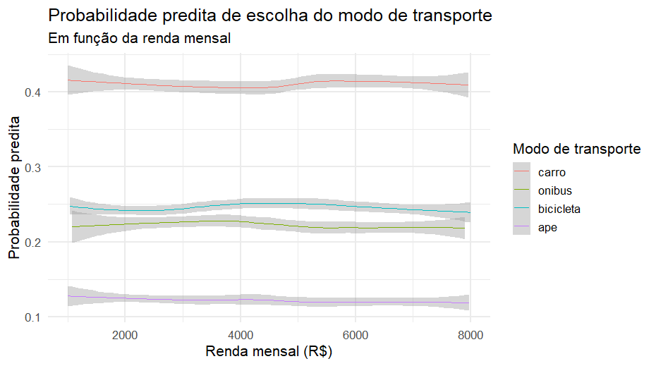

> Me explique como se eu fosse um bebê o que é e para que serve o teste de Hausman-McFadden.

Recentemente estive trabalhando em um problema e me deparei com uma dúvida sobre um teste estatístico que tive que realizar. Apelei para o \[ChatGPT\](https://chatgpt.com) da *OpenAi Inc.* que me forneceu uma resposta tão boa que resolvi reproduzí-la aqui.

Perfeito, Jobenil 😊 — vamos começar bem simples, como se estivéssemos brincando de explicar um conceito estatístico para uma criança curiosa.

## 🧸 Imagine assim:

Temos três brinquedos: um carrinho 🚗, uma boneca 🧍‍♀️ e um aviãozinho ✈️. E você pode escolher um só para brincar.

Agora, pense que algumas crianças escolhem o carrinho, outras a boneca, e outras o aviãozinho. Você quer entender por que cada uma escolhe o que escolhe. Pode ser por causa da cor, do tamanho, do barulho que faz, etc.

## 🧠 O modelo que usamos

Para estudar isso, usamos um modelo chamado **Logit Multinomial (MNL)** — ele tenta prever a **probabilidade** de uma criança escolher cada brinquedo com base em características (das crianças ou dos brinquedos).

Esse modelo tem uma regra importante chamada **IIA** — em inglês, *Independence of Irrelevant Alternatives*, ou seja:

> “A chance de escolher entre dois brinquedos não muda se eu colocar um novo brinquedo parecido na caixa.”

## Por exemplo:

Se uma criança escolhe entre 🚗 e ✈️, e gosta mais do carro, a relação entre carro e avião não deveria mudar só porque eu coloquei uma moto 🏍️ nova na caixa.

Mas... será que isso é verdade na vida real?

## 🔍 Entra o Teste de Hausman-McFadden

O Teste de **Hausman-McFadden** (ou teste **H-M**) serve para verificar se essa regra **IIA** é válida no seu modelo.

Ele faz o seguinte:

1.  Primeiro, o modelo é estimado com **todas as opções** (🚗, 🧍‍♀️, ✈️).

2.  Depois, é estimado **tirando uma das opções** (por exemplo, sem o avião ✈️).

3.  O teste compara os **coeficientes estimados** nos dois modelos.

Se não **houver diferença significativa**, quer dizer que:

> As alternativas realmente são independentes → o modelo MNL é adequado ✅

Mas se **houver diferença grande**, então:

> As escolhas não são independentes → o modelo MNL não serve bem, e precisamos de um modelo mais flexível (como o Logit Aninhado, o nested logit) 🚫

## 🎯 Em resumo:

| Conceito | Explicação “de bebê” |
|-----------------------|-------------------------------------------------|
| O que é? | Um teste para ver se as opções de escolha são realmente independentes entre si. |
| Por que serve? | Para saber se o modelo Logit Multinomial está “pensando certo” ou está enganando a gente. |
| Como faz isso? | Compara os resultados do modelo completo e de um modelo onde tiramos uma opção. |
| O que significa o resultado? | Se der diferente → o modelo está violando a regra IIA. Se der igual → o modelo é adequado. |

## 🧩 Um exemplo prático real:

Suponha que estejamos estudando o modo de transporte que as pessoas escolhem para ir ao trabalho: 🚗 carro, 🚌 ônibus, 🚲 bicicleta, 🚶‍♂️ a pé.

Se o teste Hausman-McFadden mostrar que tirar o ônibus muda os coeficientes do carro **e da bicicleta**, então significa que:

> as escolhas não são independentes — talvez quem pega ônibus também escolheria metrô, se houvesse. Logo, o modelo Logit Multinomial simples não é o mais indicado.

Fizemos uma simulação **em R**, onde tentamos representar uma situação prática — o **modo de transporte para o trabalho** — e aplicando o **teste de Hausman-McFadden** para verificar se a hipótese de independência das alternativas (IIA) é válida.

## 🚗 Exemplo: Escolha do modo de transporte

Com 4 alternativas possíveis:

-   **carro**

-   **ônibus**

-   **bicicleta**

-   **a pé**

Cada pessoa escolhe **um modo** para ir ao trabalho, dependendo de:

-   tempo de viagem (`tempo`)

-   custo da viagem (`custo`)

-   renda mensal (`renda`)

### 📊 Interpretação do resultado

O comando `hmftest()` retorna algo assim:

```         
Hausman-McFadden test  data:  modelo_completo and modelo_sem_bike chisq = 5.42, df = 3, p-value = 0.143 
```

**Interpretação:**

-   O **valor-p = 0.143** é **maior que 0.05**,\
    o que nos indica que **não rejeitamos H₀**, ou seja, que as alternativas são independentes.\
    ✅ O modelo **respeita a suposição de IIA**.

-   Se o valor-p fosse **menor que 0.05**, teríamos que rejeitar a hipótese de independência, indicando que as escolhas estão **correlacionadas** — nesse caso, o **modelo Logistico Multinomial (MNL) não seria apropriado**.



## 🧩 Resumo didático

| Etapa | O que fizemos | Por quê |
|------------------|---------------------------|---------------------------|
| 1️⃣ | Simulamos escolhas de transporte | Para ter dados realistas |
| 2️⃣ | Montamos o modelo Logit Multinomial | Para estimar preferências |
| 3️⃣ | Retiramos uma alternativa | Para testar a regra de independência |
| 4️⃣ | Aplicamos o Teste de Hausman-McFadden | Para verificar a validade do modelo |
| 5️⃣ | Interpretamos o p-valor | Para decidir se o modelo é adequado |

Se você quiser se aprofundar no assunto recomendo a leitura desse [artigo](https://statisticalhorizons.com/iia). Nele você encontrará outras referências. Obrigado pela leitura!!!

EDA \| TESTE T \| ENQUETES \| ANOVA \| MODELOS DE REGRESSÃO \| ANÁLISE FATORIAL \| MODELAGEM DE EQUAÇÕES ESTRUTURAIS \| TRI \| RASCH MODELS \| MACHINE LEARNING

{width="20" height="20"} [**Prof. Jobenil Júnior**](https://wa.me/5562992138972)
